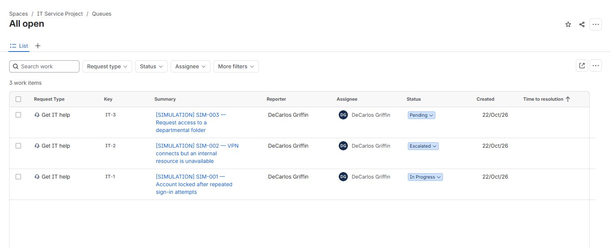

# LAB-002: Jira Service Management ticket workflow

**Date:** May 26, 2025

**Environment:** Jira Service Management Cloud, Service Collection Free signup, IT Service Project (IT).

**Result:** Three fictional support cases created, assigned, prioritized, documented with internal notes, and moved through actual Jira workflows. The planned closure demonstration remains incomplete because the resolution selection did not return any choices.

This is a hands-on ticket-management exercise. Account troubleshooting, VPN diagnostics, and access provisioning in the scenarios are hypothetical; no live account, network, or folder permissions were changed. No professional support experience or successful real incident resolution is claimed.

## Objective and starting condition

Practice recording symptoms, assessing impact, assigning ownership, distinguishing internal notes from customer replies, and selecting an appropriate ticket state. Start with the newly provisioned IT support service space and three fictional cases. The Free signup was selected; no payment details, paid upgrade, or paid add-on was used in this exercise.

## Actual work and results

1. Created three requests through Jira using the existing **Get IT help** request type and **[System] Service request** work type. Each summary begins with **[SIMULATION]**, and each description identifies the scenario as fictional.
2. Included symptoms, impact/urgency, triage questions, proposed investigation, and verification criteria. The scenario categories are descriptive text; custom request types were not configured.
3. Assigned each record to the lab owner with **Assign to me**. The lab owner is also the reporter; fictional users are only characters in the descriptions.
4. Kept IT-1 and IT-2 at Medium priority and changed IT-3 to Low. These choices use illustrative lab assumptions, not a universal priority matrix.
5. Added internal notes and submitted the transition forms. No customer replies, real team handoffs, or approval requests were sent.
6. Reopened the All open queue and verified all three saved statuses and assignments. Reloading IT-1 confirmed its attempted closure had not persisted.

| Jira key | Scenario | Priority | Verified final state | Meaning |
| --- | --- | --- | --- | --- |
| IT-1 | Account locked after repeated sign-in attempts | Medium | In Progress | Triage note saved; resolution attempt did not persist. |
| IT-2 | VPN connects but an internal resource is unavailable | Medium | Escalated | Open simulation with proposed next steps; cause unknown and no real network team contacted. |
| IT-3 | Request access to a departmental folder | Low | Pending | Pending reason: Awaiting approval. No authorization or permission change occurred. |

All three records remain unresolved. Moving IT-2 to Escalated did not transfer ownership to another person. Setting IT-3 to Pending did not implement an approval automation.

## Observed closure issue

For IT-1, the successful transition was **Waiting for support → In Progress**. Next, **Resolve this issue** opened a form whose Resolution selector displayed **No matches found**, including when searching for **Done**. An attempted update did not save a resolved state. Reloading the ticket showed **In Progress**. A separate internal note records that result.

The cause was not established. The next investigation would review available resolution values and the workflow transition configuration. No workflow or global resolution settings were changed. An optimistic status display while a transition dialog is open is not evidence that the change saved.

## Evidence

- [Selected observed results](evidence.json): manually recorded from the visible Jira interface; not a Jira API export.
- [Fictional ticket descriptions and proposed troubleshooting](ticket-scenarios.md).

The screenshot is a direct cropped capture of the queue. The crop excludes the browser address bar, site address, account-email control, and unrelated sidebar content. It retains the portfolio owner's professional name to show assignment; it contains no real customer data. Screenshot contents were not reconstructed or altered.

## Interview explanation

“I used a free Jira Service Management space to practice handling three fictional support requests. I documented impact, triage questions, ownership, internal notes, and next steps. I left the VPN case unresolved because a connected VPN indicator does not prove access to the requested resource. For the access request, I recorded the approval dependency and used least-privilege reasoning without granting access. I also caught a Jira resolution attempt that did not persist, verified the saved state, and documented the limitation.”

Useful points to explain:

- **Priority:** Determine scope, business impact, urgency, and available workarounds; apply the employer's matrix.
- **Ownership:** Assignment identifies who is responsible for follow-up, even while a request is waiting or escalated.
- **Internal notes:** Record investigation and handoff context. Customer replies are a separate communication channel.
- **Escalation:** Include symptoms, scope, time, exact error, tests and their results, and what is still unknown. Proposed tests are not actual results.
- **Access requests:** Verify identity, business need, data-owner approval, duration, and the minimum required access before provisioning.
- **Verification:** Reopen the original task after an authorized fix and confirm the actual result. For this lab, verification covered saved Jira fields, not successful account, VPN, or folder access.

## Retention and follow-up

The three practice records remain in Jira for review. No account, VPN, or permission changes need rollback. No SLA targets, automation rules, custom forms, approval workflow, or knowledge-base integration were configured or validated. Follow-up: investigate the resolution selector and complete a verified closure demonstration before claiming that step is finished.
