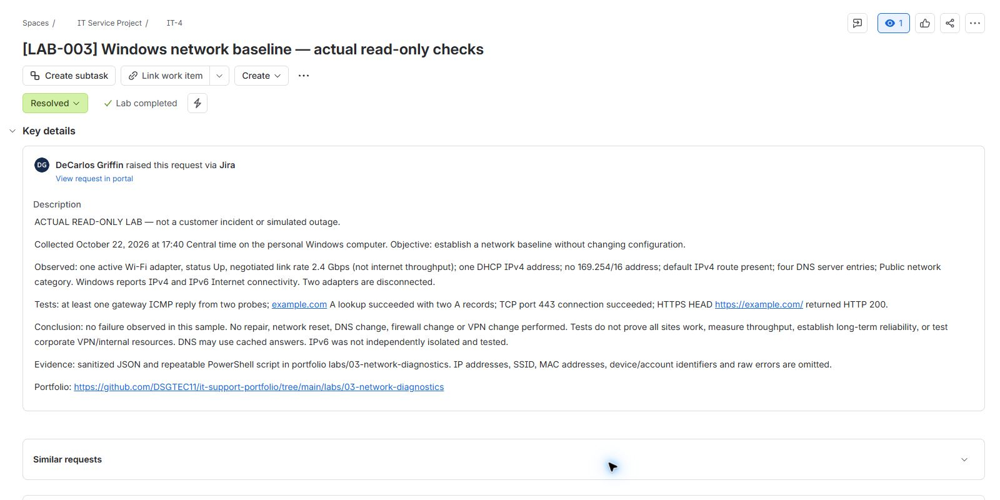

# LAB-003: Windows network baseline and connectivity checks

**Date:** June 22, 2025, 17:40 Central time. **Jira record:** IT-4.

**Completed actual lab:** Read-only checks on the personal Windows computer. No outage was injected, no fault was observed in the tested path, and no repair is claimed.

## Objective and environment

Establish a network baseline, test a public destination in stages, and explain the limits of each observation. The computer used Wi-Fi on a Public network profile. No paid service was needed. The prior [system baseline](../01-windows-baseline/README.md) documents the Windows environment.

## Actual results

| Check | Observed result | Interpretation and limit |
| --- | --- | --- |
| Active adapter | One Wi-Fi adapter Up; link rate 2.4 Gbps | Negotiated local link rate, not measured internet throughput. |
| IPv4 configuration | One address with DHCP prefix origin; no 169.254/16 address | An address is configured. This alone does not prove internet access. |
| Routing and DNS configuration | Default IPv4 route present; four DNS server entries | Configuration exists; entries may span IPv4/IPv6 and are not four independently tested resolvers. |
| Windows network classification | Public; Windows reports Internet for IPv4 and IPv6 | OS connectivity indication. IPv6 was not separately isolated and tested. |
| Gateway ICMP | At least one response from two probes | Gateway reachable during the sample. The Boolean result does not establish zero packet loss or latency. |
| DNS A lookup for example.com | Success, two A records | Name resolution worked via configured resolution behavior; cached answers may be involved. No individual DNS server was tested separately. |
| TCP port 443 to example.com | Connection succeeded | A TCP connection to the selected destination was possible; this alone is not proof of a working web application. |
| HTTPS HEAD to https://example.com/ | HTTP 200 | HTTPS request succeeded using normal certificate validation. This was a HEAD request, not a browser rendering or authenticated application test. |
| Other adapters | Two disconnected | Not evidence of a fault by itself; unused adapters can be disconnected. |

## Procedure and reproduction

1. Inspect adapter status and link speed using `Get-NetAdapter`.
2. Inspect IPv4 addresses, default routes, configured DNS entries and network profile using `Get-NetIPAddress`, `Get-NetRoute`, `Get-DnsClientServerAddress`, and `Get-NetConnectionProfile`.
3. Send two ICMP probes to the active adapter's default gateway using `Test-Connection`.
4. Resolve `example.com` A records using `Resolve-DnsName -DnsOnly` with the configured resolver behavior.
5. Test a TCP connection to `example.com` on port 443 using `Test-NetConnection`.
6. Send an HTTPS HEAD request using `Invoke-WebRequest`, with normal certificate checks and a 30-second request timeout.
7. Retain selected results only and document them in Jira.

Run [Collect-NetworkEvidence.ps1](Collect-NetworkEvidence.ps1) from PowerShell in this folder:

```powershell
& .\Collect-NetworkEvidence.ps1
```

The default output replaces `evidence.json` with a new timestamped observation. To preserve the original capture, supply a different `-OutputPath`. The script reads configuration and sends diagnostic traffic; it does not change configuration. Run only on networks you are authorized to test. It omits sensitive identifiers before writing output. A failed DNS/HTTPS test records failure but intentionally does not retain raw error details; diagnosis would require a local follow-up.

## Verification and Jira documentation

The [sanitized JSON](evidence.json) was produced by the script on the actual computer, not typed from expected outcomes. The script completed successfully; the JSON was parsed and the selected results reviewed. Jira IT-4 contains the observed results and limitations, is assigned to the lab owner, and has Low priority because this is planned lab work with no outage. A global resolution named **Lab completed** was added for actual completed labs; it does not imply incident repair. No default resolution or workflow definition was changed. IT-4 was closed as **Resolved / Lab completed**; status, resolution, Low priority and assignment were verified after reloading.



## Privacy, cleanup, and limitations

The evidence omits addresses (local/public IP, gateway, DNS), SSID, MAC address, adapter descriptions, device/account identifiers, and raw exception messages. The direct Jira screenshot crop excludes the account email and site address; the portfolio owner's professional name remains. No employer or customer data was used.

No settings changed, so no network rollback was needed. No DNS cache flush, adapter reset, restart, firewall change, VPN change, credential change, speed test, or internal-resource test was performed. Successful results describe one short sample to one public destination; they do not prove all sites work or long-term reliability. No baseline comparison or fault reproduction was performed.

## Interview explanation

“I collected an actual Windows network baseline and tested connectivity in stages: adapter and IP configuration, gateway reachability, DNS, TCP 443, then HTTPS. All checks passed for the public test destination, so I documented no fault observed instead of claiming a repair. I explained that link speed is not internet throughput and that a successful ping alone does not prove an application works. I saved sanitized evidence, a repeatable script, and a Jira record.”

If a later test fails, compare against this baseline, capture the exact error and time locally, identify the scope, and investigate one layer at a time before making authorized changes.
